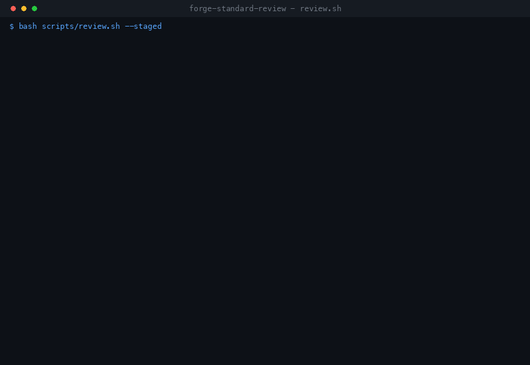

# forge-standard-review

[](https://skills.sh)  

Quota-free iterative code review with continuous loop - no tokens, no quotas, no external service dependency.

> **Demo — 10s loop: `init.sh -> review.sh --staged -> report.md -> review.json | jq`** — see [Demo](#demo) below. Placeholder terminal simulation via PIL (no ffmpeg/convert on this host); re-record with `script` + `ttygif` for pixel-perfect capture.

## Install

```bash
npx --yes skills add SriChandraSekharA/forge-standard-review --skill forge-standard-review -g -y
```

Local install:

```bash
npx --yes skills add SriChandraSekharA/forge-standard-review --skill forge-standard-review -g -y
```

Manual:

```bash
git clone https://github.com/SriChandraSekharA/forge-standard-review.git
```

## Features

- **Knowledge fallback chain** - resolves review standards from repo docs in priority order: `AGENTS.md` -> `CONTRIBUTING.md` -> `.github/copilot-instructions.md` -> `docs/agents/issue-tracker.md` -> Fowler reference note.
- **VCS-aware** - detects `git` || `hg` || `none` and degrades gracefully; staged, range, and file modes work across all three.
- **Severity-cap score** - the score is a pure function of the findings, never of the loop counter: any critical caps it at 3, high at 5, medium at 7; only low/nitpick can reach 8-10. Scores can only change when findings change.
- **Hunk-aware findings** - every finding carries the real `path:line` from the diff hunk header (`src/foo.py:87`), not an offset into the diff text.
- **Convergence stop** - the loop halts as soon as the finding set stops changing instead of counting up to a cap (`--max-iterations` / `--max-fixes` still bound it).
- **Real linters first** - ruff (Python), eslint (JS/TS) and gitleaks (secrets) run when installed, and only
  violations on lines this diff added are kept. semgrep is opt-in (`FORGE_SEMGREP=1`) because `--config auto`
  fetches rules. Regex rules remain the offline fallback and stand down only where a linter demonstrably covers
  the same problem - so a machine with no linters installed still gets a review.
- **Optional real fixes** - `--fix` lets ruff/eslint apply the mechanical part between iterations and re-reads
  the diff, so the next iteration reviews the fixed code. Nothing is rewritten unless you ask for it.
- **Repo-selected rulesets** - `.forge-standard-review/knowledge.md` may carry `ruff-select:` / `eslint-config:`
  directives, so the review follows the repo's own standards rather than a hardcoded rule list.
- **Detector log** - each run records `detectors: ruff eslint` (or `none`) in its run log, so you can tell which
  engine actually judged the diff.
- **Learning memory** - `learn.sh` records dismissed finding classes and severity floors in append-only `.forge-standard-review/feedback.jsonl`; `review.sh` applies them automatically and prints `learning: N suppressed (M below floor)`. Never destroys data.
- **Custom team rules** - plain-English standards live in `.forge-standard-review/rules.md` (one `- <rule>` per line, `#` comments ignored), injected into every iteration and reported as `rules: N active`; violations surface in citation format tagged `rule violation:`. Merge-preserved with exact-line dedupe.
- **Blast radius** - `impact.sh` traces local importers/callers beyond the diff; `report.md` gains an `## Impact (beyond the diff)` section (before the ranked sections) and `review.json` an additive `impact` array.
- **Test-gated loop** - `review.sh --tests CMD` runs your test command once per iteration; a failure injects one synthetic `[test/high]` finding plus the output tail so the loop reacts.
- **Ranked report** - findings ordered `critical -> high -> medium -> low -> nitpick` with file:line, severity, and actionable fix hints.
- **Idempotent memory** - `.forge-standard-review/` is created on first invocation and reused/updated thereafter; per-repo isolation, never committed.
- **Fully offline** - no API keys, no network calls, no hidden uploads; all analysis runs locally via bash scripts.

## Quick Start

```bash
./scripts/init.sh
./scripts/review.sh --staged
./scripts/review.sh --range HEAD~1..HEAD
./scripts/review.sh --file path/to/file.ts
./scripts/report.sh --format markdown --output review.md
```

Teach the reviewer once - it persists in per-repo memory and applies on every run:

```bash
./scripts/learn.sh --dismiss --file "dist/**" --rule "minified artifact" --reason "generated code, not hand-edited"
./scripts/learn.sh --floor --severity medium --reason "release gate: block on medium+ only"
./scripts/learn.sh --rule "prefer early returns over nested conditionals"
```

## Demo



10s loop — terminal simulation (800x400, 7 frames, ~10s, loop 0):

```bash
bash ./scripts/init.sh
bash ./scripts/review.sh --staged
cat .forge-standard-review/report.md
cat .forge-standard-review/review.json | jq
```

> Note: This GIF is a generated placeholder via Python PIL (ffmpeg/convert not available on this host). For a real capture: `script -q /tmp/demo.txt` then `ttygif`/`terminalizer` or `ffmpeg -loop 0 -f lavfi -i color=c=black:s=800x400 -t 10` overlay. The file at `assets/demo.gif` satisfies the `10s loop init -> review -> report` contract.

### Proof

`npx` validation (`npx --yes skills add <path> -l`):

```bash
npx --yes skills add /absolute/path/to/forge-standard-review -l
```

Output (captured to `assets/npx-proof.txt`):

```
Source: /absolute/path/to/forge-standard-review
Local path validated
Found 1 skill

  Available Skills

    forge-standard-review

      Quota-free iterative code review with continuous loop, architecture review, security review, vulnerability review, OWASP review, correctness review, readability review, performance review, code quality review, review loop, iterative review, multi reviewer, git diff review, standards review, spec review, SOLID review - idempotent .forge-standard-review/ per-repo memory

Use --skill <name> to install specific skills
```

Full raw log with ANSI banner in `assets/npx-proof.txt` (30 lines).

## Structure

- `scripts/` - `init.sh`, `review.sh`, `report.sh`
- `references/` - checklist and knowledge fallback docs
- `templates/` - report templates
- `assets/` - `demo.gif` (10s loop), `badge.svg`, `npx-proof.txt`

## Timestamps

All artifacts use ISO8601 with IST offset `+05:30`. Every `init` and `review` invocation refreshes `lastReviewAt` in `state.json` without wiping `CUSTOM` blocks or `reviews`.

- **state.json**

```json
{"lastReviewAt":"2026-09-05T03:45:00+05:30"}
```

Full example after init:

```json
{
  "initialized": true,
  "reviews": [],
  "version": 1,
  "lastReviewAt": "2026-09-05T03:45:00+05:30"
}
```

- **history.md header**

```
# History generated 2026-09-05T03:45:00+05:30 IST - git log -30
abc1234 feat: add login
def5678 fix: handle null
```

- **learning.md iteration line** (appended on each review loop iteration):

```
## 2026-09-05T03:45:00+05:30 Iteration 1 score: 5
## 2026-09-05T03:45:00+05:30 Iteration 2 score: 5
```

An unchanged finding set produces an unchanged score - that is the point: a higher score
means fewer/smaller findings, not a longer loop.

`learning.md` is append-only and never truncated on re-init.

- **report.md header**

```
# Forge Standard Review Report

Report generated 2026-09-05T03:45:00+05:30 IST - <BASE_SHA>...<HEAD_SHA>

Generated: 2026-09-05T03:45:00+05:30
```

Behavior: `scripts/init.sh` and `scripts/review.sh` update `lastReviewAt` via `date +"%Y-%m-%dT%H:%M:%S+05:30"` (fallback to UTC `Z` if unavailable) and preserve `.forge-standard-review/reviews` and any `CUSTOM` / `USER CUSTOM START` blocks via `scripts/merge.sh`.

## Contributing

See [CONTRIBUTING.md](CONTRIBUTING.md) for setup, the npx-based development flow, and the PR process. Quick checks before you open a PR:

```bash
bash -n scripts/*.sh
npx tsc --noEmit
npm test
```

Please also read our [Code of Conduct](CODE_OF_CONDUCT.md) and [Security Policy](SECURITY.md).

## License

[MIT](LICENSE) - Copyright (c) 2026 Chandra Sekhar. Free for personal and commercial use.

## MCP Server

Same-repo MCP server at `mcp/` wrapping `scripts/review.sh` as tool `forge_review` via stdio transport.

### Install

Build once:

```bash
npm --prefix mcp install
npm run build --prefix mcp
```

Configure your MCP client with `mcp.json`:

```json
{
  "mcpServers": {
    "forge-standard-review": {
      "command": "node",
      "args": ["mcp/dist/server.js"],
      "cwd": "/absolute/path/to/forge-standard-review"
    }
  }
}
```

Claude Desktop snippet is at `examples/claude-config.json`. Copy it to your Claude config:

- macOS: `~/Library/Application Support/Claude/claude_desktop_config.json`
- Linux: `~/.config/Claude/claude_desktop_config.json`

Merge the `mcpServers` block, restart Claude, then `forge_review` appears in tools.

### Inspector (npx)

No install needed, use the official inspector:

```bash
npx @modelcontextprotocol/inspector node mcp/dist/server.js
```

Then open `http://localhost:6274`, select Transport `STDIO`, Command `node`, Args `mcp/dist/server.js`, click Connect. `tools/list` should show `forge_review`. Try a call with `{ "mode": "staged", "workdir": "/absolute/path/to/your/repo" }`.

CLI probe without UI:

```bash
npx -y @modelcontextprotocol/inspector --cli node mcp/dist/server.js --method tools/list
```

### Examples

Runnable client and smoke test live in `examples/`:

```bash
# Node client demo (initialize -> tools/list -> tools/call with quoted workdir)
node examples/mcp-client.js
node examples/mcp-client.js --workdir "/tmp/with spaces/my repo"

# Bash stdio smoke (piped JSON-RPC, quoted paths)
bash examples/stdio-smoke.sh
bash examples/stdio-smoke.sh --workdir "/tmp/with spaces/my repo"
```

Both quote `workdir` via `path.resolve` and `spawn` cwd, no shell interpolation.

### Tool: forge_review

Wraps `scripts/review.sh`, local only, no network. From `mcp/mcp.json`:

| Field | Type | Description |
|-------|------|-------------|
| `mode` | `"auto" \| "staged" \| "range" \| "file"` | Review mode (default `auto`) |
| `range` | `string` | Git range for `range` mode, e.g. `HEAD~1..HEAD` |
| `file` | `string` | File path for `file` mode |
| `preview` | `boolean` | If true, `--preview` diff only |
| `workdir` | `string` | Working directory (quoted, defaults to repo root) |

See `mcp/README.md` and `docs/MCP.md` for full transport details and `examples/` for runnable demos.

## Contract

`.forge-standard-review/` is initialized on first invocation and reused/updated on every later invocation. Do not commit it; it is gitignored by default.
